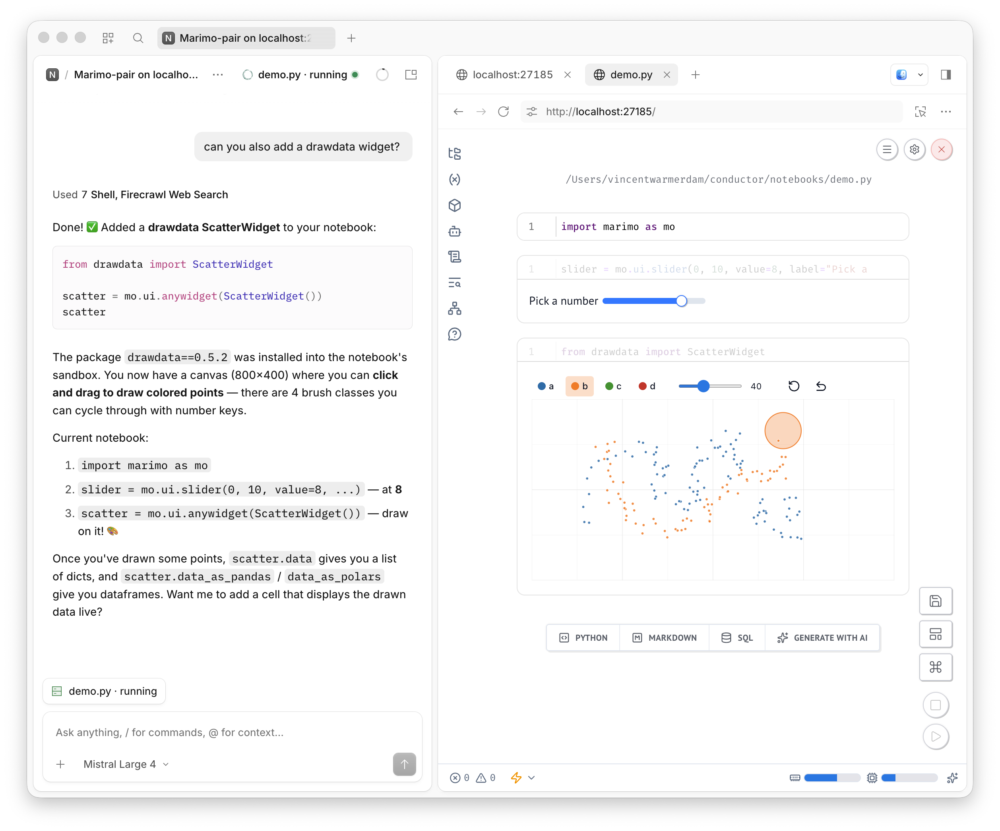

# opencode-marimo

Some small utilities to give every OpenCode session its own live [marimo](https://marimo.io) notebook. Think of it as [Claude Science](https://www.anthropic.com/news/claude-science-ai-workbench), but more open. 



The agent pairs with the running kernel through the [marimo-pair](https://github.com/marimo-team/marimo-pair) skill,
so it runs cells and installs packages (sandboxed with uv) while you use the same notebook. We also bind notebooks to 
individual sessions, so you can rest easy that only one agent is working on a notebook at the same time. 

## Usage

- <kbd>Cmd</kbd>+<kbd>K</kbd> → **New marimo session**
- or click **marimo** in the session header, or type `/marimo` in any session

## Install

Requires OpenCode Desktop 2.2.5+ and [uv](https://docs.astral.sh/uv/). [marimo](https://docs.marimo.io/getting_started/installation/)
is used when it's installed; otherwise notebooks run through `uvx marimo`.

```sh
npx skills add marimo-team/marimo-pair
bun install && bun run build
```

Add the plugin to `~/.config/opencode/opencode.json` and restart OpenCode Desktop:

```jsonc
{
  "plugins": [{ "package": "/path/to/opencode-marimo", "options": { "command": "marimo" } }],
}
```

`command` is optional: an absolute path to marimo if it isn't on a standard path.

### Remote sessions (SSH)

Notebooks run on the machine that runs the session's OpenCode server, so a session on an SSH server gets its notebook
on that server, and the side pane reaches it through Desktop's own connection. The plugin has to be installed in both
places:

- **This machine**, as above: Desktop loads the plugin's interface from here.
- **The remote machine**: copy the plugin there (`rsync -a --exclude node_modules ./ host:opencode-marimo/`), add it
  to that machine's `~/.config/opencode/opencode.json`, and make sure it has uv. Copy the marimo-pair skill too
  (`~/.agents/skills/marimo-pair`), so the agent there can pair. The server picks up the config change on its own.

Each server keeps its own notebooks and settings in `~/.local/state/opencode-marimo/state.json` on its machine.

## Settings

**Settings → marimo** (for notebooks on this machine; set a remote server's with `options`) (or <kbd>Cmd</kbd>+<kbd>K</kbd> → **marimo settings**) has a switch for
[marimo-studio](https://github.com/marimo-team/marimo-studio), which adds Notebook and Preview views for building
reports, slides and papers from the notebook's results. With it on, notebooks start through
`uvx --with marimo-studio marimo edit …`, and the session's agent is told to read Studio's instructions before it
builds views. Studio is experimental, so you can pin a version (`0.4.1` or `marimo-studio==0.4.1`) in the field under
the switch.

Changes apply the next time a notebook starts: stop it from the marimo pill and open it again. To turn Studio on
before you ever open Settings, add `"studio": true` (or a version) to the plugin's `options`.

## Develop

```sh
bun run dev        # rebuilds and reloads the GUI on save
bun run typecheck
```
